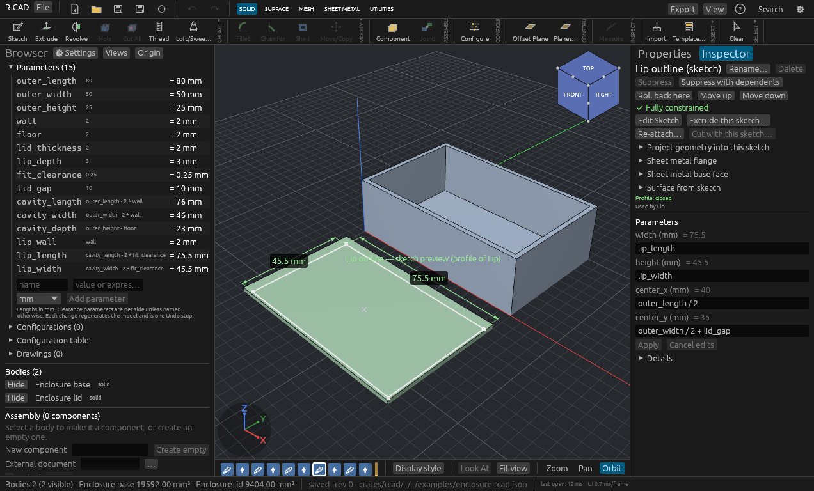
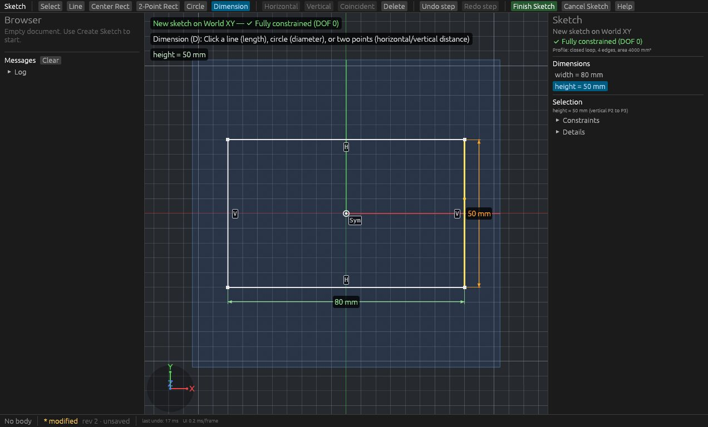
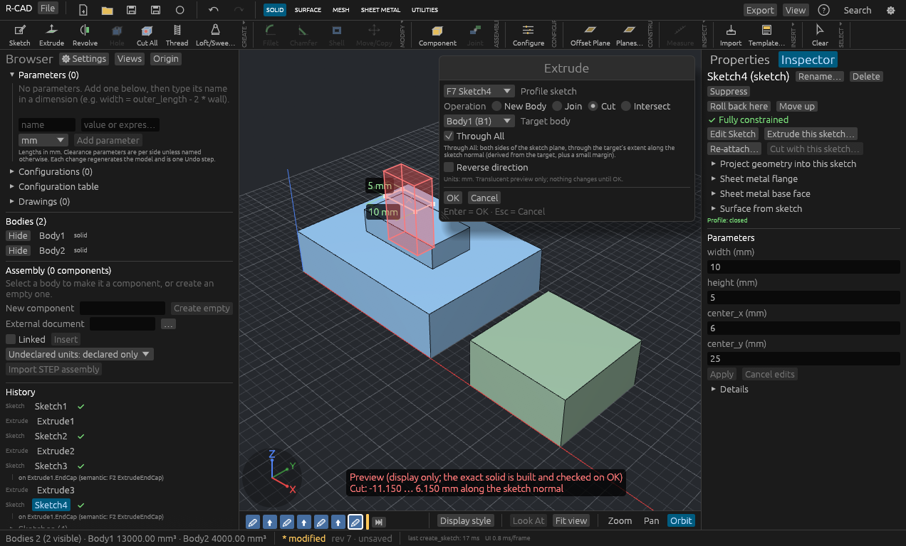
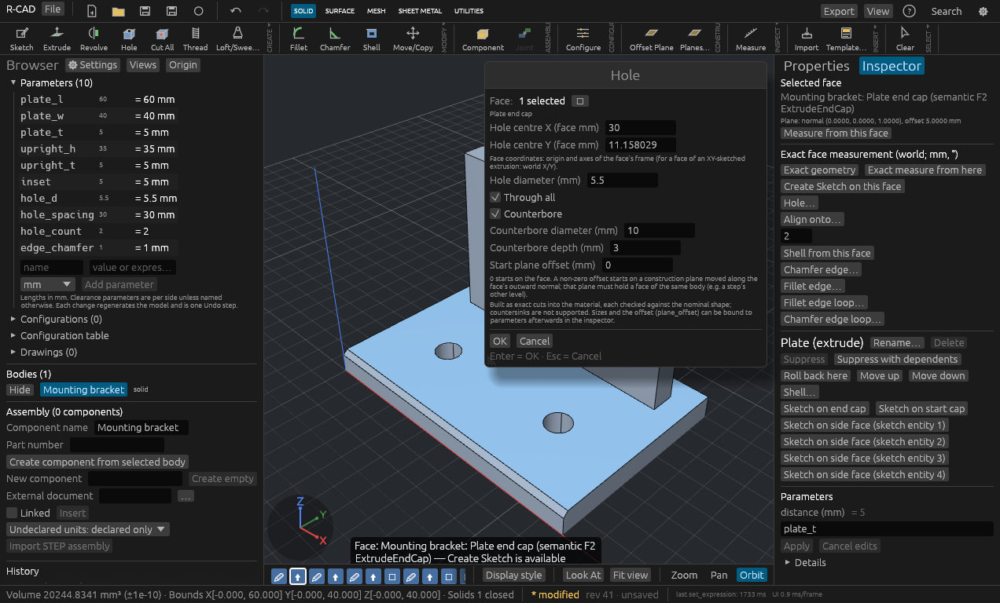
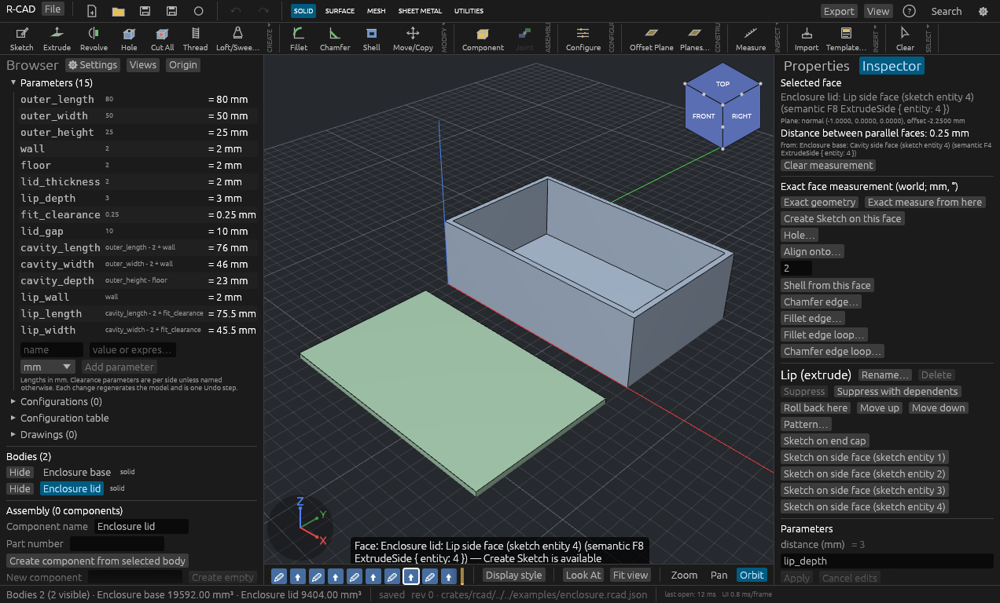
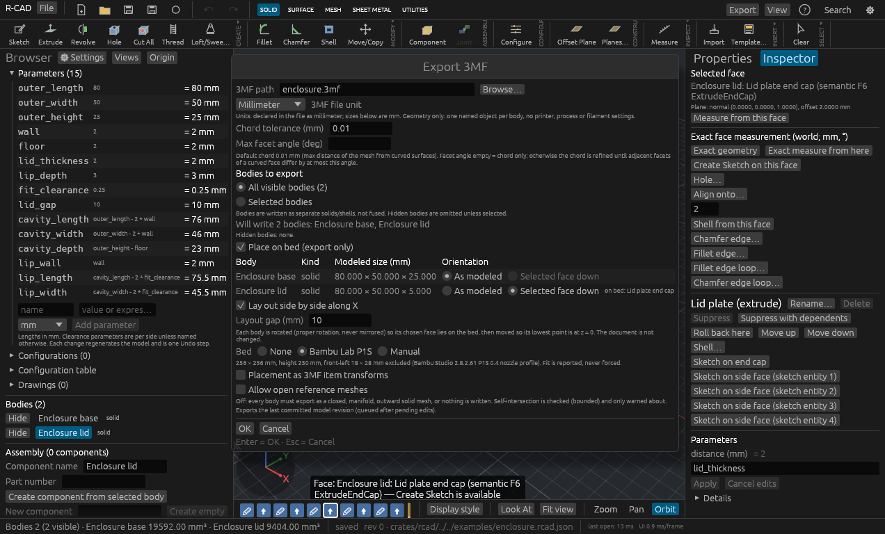
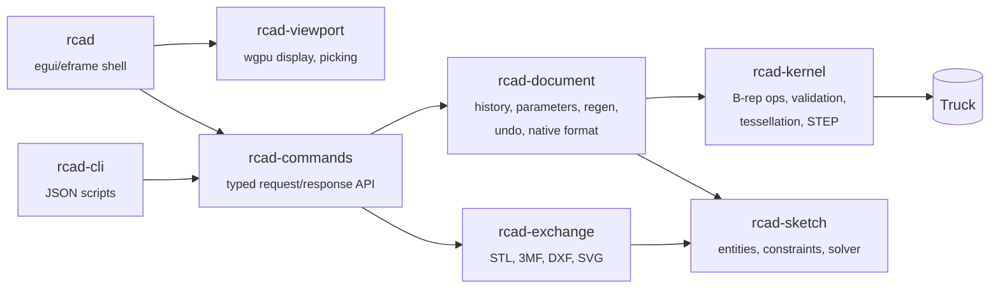

<div align="center">

# R-CAD

**A local-first parametric CAD modeler for small mechanical parts, written in Rust.**

*The **R** is for **Rust**, and it is said like "our": R-CAD is **our CAD**. It runs on
your machine, keeps your files in an open format, and is small enough to read and change.*

Constraint-based sketches · feature history · exact B-rep solids · named parameters ·
STEP / STL / 3MF / DXF / SVG · a headless command API

[](https://github.com/aped/R-CAD/actions/workflows/ci.yml)




<sub>A parametric enclosure driven by 15 named parameters. Every dimension is an expression
such as <code>cavity_length - 2 * fit_clearance</code>.</sub>

</div>

---

## Why

Most hobby-grade parametric CAD is cloud-bound, closed, or built on a large C++ kernel.
R-CAD is a small, inspectable modeler that does a few things properly:

- **Exact geometry.** Solids are analytic B-rep, built through
  [Truck](https://github.com/ricosjp/truck); tessellation is a derived cache. Volumes and
  areas are measured from the B-rep, not from a mesh.
- **Real history.** Features store parameters and semantic face references ("end cap of
  *Base*"), not triangle indices, so upstream edits regenerate downstream features or
  report a broken reference. They never silently pick another face.
- **Transactional edits.** Every change is checked before it commits. A failed operation
  keeps the previous valid model and returns a structured error. Undo and redo restore
  parameters and references.
- **Headless first.** Everything the UI can do goes through a typed, serialisable command
  API. That API is shared by the desktop app, a JSON-scripted CLI and the test suite.
- **Pure Rust kernel adapter.** No application-owned C/C++ geometry code; no remote service.

## Features

| | |
|---|---|
| **Sketching** | Lines, rectangles, circles, three-point arcs, ellipses, cubic splines, slots, regular polygons, sketch patterns, fillets, offsets, trim/extend, text from installed fonts; associative projection of faces, single edges (oblique circles become exact ellipses), body sections and other sketches; dimensions and geometric constraints; a solver that reports residuals, remaining degrees of freedom and conflicts |
| **Solids** | Extrude (new body / join / cut / intersect; symmetric, two sides, start offset, up to a plane, thin, taper, several regions), revolve about any sketch axis or line (also sections drawn against the axis, e.g. cups and knobs), multi-section loft, sweep, holes with counterbores and countersinks, modeled threads (faceted), linear (one or two directions), circular patterns, mirror, convex and concave solid fillets, fillet and chamfer of a face's whole edge loop (tori and sphere corners, also on shelled enclosures), chamfers, shell from a face, ribs, sheet-metal contour flange with flat pattern; body move/copy/scale/align/split/combine; cuts that separate a body make one body per piece; direct edits of imported STEP faces and holes |
| **History** | Suppression, timeline rollback marker, safe reorder, re-attach and unlink repairs, configurations (named variants with part numbers) |
| **Assemblies** | Nested components with linked occurrences, rigid/revolute/slider/cylindrical/pin-slot/planar/ball joints with limits, BOM, static interference and sampled sweep checks, exploded views, STEP assembly import/export |
| **Drawings** | Base, projected, section and detail views (first/third angle), hidden lines, automatic dimensions and hole callouts, title block; SVG, PDF and DXF |
| **Parameters** | Named user parameters with units and expressions (`outer_length - 2 * wall`); each change is one undo step; impossible values are refused with the model unchanged |
| **Inspection** | Exact face measurements (distances, angles, radii, axes), per-body volume, materials and mass properties (mass, centre of mass, inertia), bounds and topology, section view |
| **Mesh** | Mesh diagnosis (boundaries, non-manifold, orientation, duplicates, components, bounded self-intersection check), repair, transform/unit conversion, plane cut with caps, decimation with measured deviation |
| **Print export** | STL / 3MF with chord control, separate objects with their own transforms, place-on-bed by face, side-by-side layout, bed-fit check (Bambu Lab P1S preset), closed/manifold mesh verification |
| **Interchange** | STEP import/export (exact B-rep subset, assemblies, surface bodies), STL and 3MF import/export, DXF and SVG sketch import/export. See [`docs/FORMAT_SUPPORT.md`](docs/FORMAT_SUPPORT.md) |
| **Native format** | Versioned `.rcad.json` (v8; older versions written when newer features are unused) with automatic migration from v1–v3 and atomic saves that never destroy the previous file |

## Screenshots

<table>
<tr>
<td width="50%"><br><sub><b>Sketch.</b> A fully constrained centre rectangle (DOF 0) with driving dimensions.</sub></td>
<td width="50%"><br><sub><b>Extrude.</b> A through-all cut previewed in red before it is committed; the exact solid is built and checked on OK.</sub></td>
</tr>
<tr>
<td><br><sub><b>Holes.</b> A counterbored hole placed on a semantic face of a parametric mounting bracket.</sub></td>
<td><br><sub><b>Measure.</b> The lid lip's 0.25 mm fit clearance against the enclosure cavity wall.</sub></td>
</tr>
<tr>
<td colspan="2"><br><sub><b>Print export.</b> Both bodies to 3MF: lid turned face-down onto the bed, laid out side by side, checked against the printer's bed.</sub></td>
</tr>
</table>

More in [`docs/screenshots/`](docs/screenshots).

## Getting it

### Prebuilt binaries

CI publishes unsigned builds for **Linux x86_64**, **Windows x64** and **macOS ARM64** from
`main` and from manual runs (Actions → CI → a run → *Artifacts*; kept 7 days). Tagged
versions (`v*`) produce a draft release with the same archives. Each archive holds `rcad`, `rcad-cli`, the example
documents and a `BUILD_INFO.txt` that says whether that platform's tests passed.

> Windows and macOS builds are produced on every run but are not yet test-gated; see
> [`docs/CI.md`](docs/CI.md) for the known platform issues.

### From source

Requires Rust **1.95+** (CI uses 1.99.0) and a C compiler (one dependency builds liblzma).

```bash
git clone https://github.com/aped/R-CAD.git
cd R-CAD
cargo build --release -p rcad -p rcad-cli
target/release/rcad            # F1 = help
```

On Linux the app runs on Wayland or X11 with Vulkan or GL; nothing beyond the usual desktop
libraries is needed at build time.

## Five-minute tour

1. **New Sketch on XY** → **R** (centre rectangle): click the origin, click a corner →
   **D** (dimension): click an edge, type a value, Enter → **Finish Sketch**.
2. **Extrude…**, Enter. Click the top face → **Create Sketch** → **C** circle → **Finish** →
   **Cut through all…** (or **Blind depth**).
3. Select the sketch in the browser and click a dimension in the 3D view to change it; undo
   with Ctrl+Z.
4. **Templates → Printable parts → Parametric enclosure + lid**, then change
   `outer_length` in **Browser → Parameters** and watch base and lid regenerate together.
5. **Export → Export 3MF…**, tick *Place on bed*, and open the result in your slicer.

Navigation: middle-drag orbit, right-drag pan, wheel zoom, **F** fit, **7 / 1 / 3 / 0**
standard views.

## Headless use

Every modeling action is a JSON command. Workflows in [`examples/`](examples) are plain
scripts:

```bash
target/release/rcad-cli run examples/enclosure_workflow.json      # build, edit, save, export
target/release/rcad-cli acceptance --out artifacts/acceptance     # analytic acceptance checks
```

```json
[
  { "cmd": "new_document" },
  { "cmd": "set_user_parameter", "name": "outer_length", "expression": "80", "unit": "mm" },
  { "cmd": "set_user_parameter", "name": "cavity_length", "expression": "outer_length - 2 * wall", "unit": "mm" },
  { "cmd": "set_expression", "feature": 1, "name": "width", "expression": "outer_length" }
]
```

Responses carry feature IDs, structured errors and measured geometry (volume, bounds,
mesh checks). The command reference is [`docs/COMMANDS.md`](docs/COMMANDS.md).

## Architecture



Geometry and document crates build and run without a window or GPU. Decisions are recorded
in [`docs/adr/`](docs/adr); every tolerance and its rationale is in
[`docs/TOLERANCES.md`](docs/TOLERANCES.md).

## Testing

```bash
cargo xtask check     # layout, fmt, clippy -D warnings, release tests, acceptance, example replays
```

- **Around 580 tests.** They use analytic expected values (volumes, bounds, Pappus,
  divergence-theorem checks), not snapshots of the program's own output.
- **Malformed input.** Truncation and byte-mutation sweeps over every importer and the
  native format must return errors, never panics.
- **Committed print exports** are read back and checked against analytic volumes.
- **UI.** Real widgets are driven headlessly with `egui_kittest` (no GPU or display needed).
- **Independent validation.** FreeCAD and an independent mesh checker validate the STEP/STL
  output (`tools/external_validation.sh`), and Bambu Studio slices the print examples.
- **CI** runs the same gate on Ubuntu 24.04, Debian 13, Windows x64 and macOS ARM64
  ([`docs/CI.md`](docs/CI.md)). `tools/ci/container_check.sh debian:trixie` reproduces a
  Linux leg locally with podman.

## Status and limits

R-CAD is a **prototype**. It is useful for prismatic, revolved and lofted parts and printable
enclosures. Solid fillets cover straight prismatic edges and whole edge loops of a cap face
(tori, sphere corners, mitred corners, also after a shell); arbitrary corner blends and
variable radii are not implemented. Threads are faceted (within 0.01 mm), not exact
helicoids. Some coplanar or coincident boolean cases are still refused, and curved booleans
can take seconds to tens of seconds. Drawings use sampled hidden-line removal. Every
Join/Cut result is independently checked before it commits (ADR 0005), so an unsupported
case fails loudly instead of producing wrong geometry; a running regeneration can be
cancelled from the toolbar. Example exports are validated in CAD and slicer software but
have **not** been physically printed (sliced is not printed).

Linux (Bazzite / Fedora atomic) is the primary development platform. Windows and macOS
builds are produced by CI and are being brought up to the same test bar.

The roadmap is in [`docs/ROADMAP.md`](docs/ROADMAP.md).

## Documentation

| | |
|---|---|
| [`docs/COMMANDS.md`](docs/COMMANDS.md) | command API and native format |
| [`docs/FORMAT_SUPPORT.md`](docs/FORMAT_SUPPORT.md) | what each interchange format really supports, with evidence |
| [`docs/PARAMETERS.md`](docs/PARAMETERS.md) | named parameters and expressions |
| [`docs/PRINT_EXPORT.md`](docs/PRINT_EXPORT.md) | STL/3MF print export, placement, validation, slicing |
| [`docs/behavior/sketching.md`](docs/behavior/sketching.md) | sketch editor behaviour |
| [`docs/TOLERANCES.md`](docs/TOLERANCES.md) | every tolerance and why |
| [`docs/CI.md`](docs/CI.md) | CI matrix, toolchain pin, platform refactor plan |
| [`docs/ASSEMBLIES.md`](docs/ASSEMBLIES.md), [`docs/DRAWINGS.md`](docs/DRAWINGS.md), [`docs/SHEET_METAL.md`](docs/SHEET_METAL.md), [`docs/MATERIALS.md`](docs/MATERIALS.md) | assemblies, drawings, sheet metal, materials (supported subsets) |
| [`docs/adr/`](docs/adr) | architecture decisions |
| [`docs/DEPENDENCIES.md`](docs/DEPENDENCIES.md) | dependency licences |

## License

Licensed under either of [Apache License, Version 2.0](LICENSE-APACHE) or
[MIT license](LICENSE-MIT) at your option.

R-CAD is an independent project and is not affiliated with any commercial CAD vendor.
